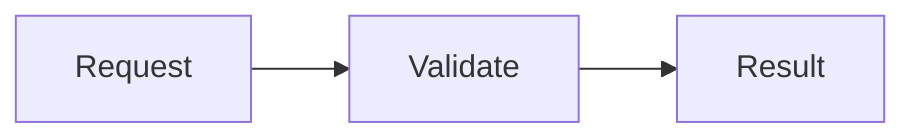

# Siada CLI User Manual

**[简体中文](./zh-CN/USERMANUAL_zh.md) | English**

This user manual provides detailed usage instructions for Siada CLI, helping you make full use of this powerful AI workflow tool.

## Overview

Siada CLI is a professional command-line AI workflow tool designed specifically for code development, debugging, and automation tasks. It provides multiple intelligent agents, each optimized for specific development tasks.


## Configuration

### Model Configuration

**Method 1: Default Configuration**
   - The system reads default configuration from `agent_config.yaml` file
   - Current defaults: model `claude-sonnet-4.5`, provider `li`

   **Method 2: Customize via Configuration File**
   - Regular Users
      - Edit configuration file `~/.siada-cli/conf.yaml`
         ```bash
         # 1. Create configuration file in user home directory
         cd ~
         mkdir -p ~/.siada-cli
         touch ~/.siada-cli/conf.yaml

         # 2. Configuration file content example
         llm_config:
            model: "claude-sonnet-4.5"          # Change to your desired model
            provider: "li"
         ```
   - Developer Mode
      - Edit the `llm_config` section in `agent_config.yaml` file:
         ```yaml
         llm_config:
            provider: "li"
            model_name: "claude-sonnet-4.5"     # Change to your desired model
         ```

   **Method 3: Via Environment Variables**
   ```bash
   # Set model
   export SIADA_MODEL="claude-sonnet-4.5"
   
   # Set provider
   export SIADA_PROVIDER="li"
   ```

   **Method 4: Via Command Line Parameters (Highest Priority)**
   ```bash
   # Only change model (keep provider unchanged)
   siada-cli --model claude-sonnet-4
   
   # Change both model and provider
   siada-cli --model gpt-4.1 --provider li
   
   # Only change provider (keep model unchanged)
   siada-cli --provider li
   ```

   > **Important Notes:**
   > - **Complete Priority**: `Command line parameters` > `Environment variables (SIADA_ prefix)` > `Configuration file (agent_config.yaml)`

When using Siada through chrome-acp, selecting a model saves it to
`llm_config.model` in `~/.siada-cli/conf.yaml`. New sessions and agent restarts
use the saved model. Other configuration fields and comments are preserved.
If saving fails, the model switch reports an error and the current model stays active.

### Forking a Conversation

Use `/fork` to create and switch to a new session inheriting the current
conversation, or `/fork <session_id>` to derive it from a saved session.
`/fork <index>` uses the current project's `/resume` list, and `/fork latest`
uses its latest nonempty saved session. The source must belong to the current
workspace.

The new session has its own ID and storage directory and retains conversation
history, compacted effective context, todos and goal state. Future turns write
to the new session; the source history stays available through `/resume`.
Forking captures saved conversation state and does not copy workspace files
or running sub-agent processes. This command is available in the terminal CLI.

### Goal Verification Limit

The `/goal` verifier stops automatic continuation when it has no actionable
`nextAction`, or when the maximum number of consecutive failed verifier turns
is reached. Configure the limit in `~/.siada-cli/conf.yaml`:

```yaml
goal:
  max_turns: 6
```

The default is `6`. A transient verifier system error automatically schedules
another goal turn. Two consecutive verifier system errors trigger a separate,
faster safety breaker. Internal follow-up turns, including background task
results, do not reactivate a blocked goal; a new user message does. Completed
goals retain their final status, elapsed time and verification rounds while
waiting, including after session restoration. The next user conversation
archives the completed goal and removes its status bar; verification records
stay in history. Use `/goal clear` to remove it sooner, or `/goal <objective>`
to replace it. When there
is a goal to clear, `/goal clear` persists a hidden reminder in the session
history so the model knows not to resume it. If the history write fails, the
goal is still cleared and a warning is shown; the model may not receive the
reminder on its next turn.

To test Goal retry transitions, start the CLI with forced verification errors:

```bash
SIADA_GOAL_VERIFIER_FORCE_ERROR=1 siada-cli
```

Start a fresh Goal with `/goal <objective>`. Every verification attempt raises
an injected exception: the first schedules another goal turn, and the second
consecutive error stops automatic continuation with `blocked`. An existing Goal
may already have errors counted. Unset the variable and restart the CLI to
restore normal verification.

`/resume <id>` and `siada-cli --resume <id>` restore the goal status and current
todo list immediately. Resuming alone does not restart a blocked goal; your
next conversational message reactivates it and resumes verification. Internal
verification reminders remain hidden in the TUI. Todo lists that have already
been cleared or completed are not revived from older history.

### External Model Configuration

If you need to configure custom external models (such as privately deployed model services), please refer to the [External Model Configuration Guide](./external_model_configuration.md). This document provides detailed information on how to configure and use external models, including:
- Model naming conventions
- API connection configuration
- Protocol mapping explanation
- Configuration examples

### Standalone Model Requests

Session titles, memory slugs/summaries, browser-skill classification/matching,
context compression, and image transcription use one Agents SDK model call
through Siada's `ModelProviderWrapper`. These auxiliary requests do
not start an Agent/Runner tool loop or write their prompts into the main session.
Providers retain their model-specific Chat Completions/Responses/vendor routing.

To select a separate model for fast helper requests, configure
`~/.siada-cli/conf.yaml`:

```yaml
fast_llm_config:
  model: "gpt-4o-mini"
  provider: "default"
  base_url: "https://gateway.example/v1"
  api_key: "YOUR_API_KEY"
  extra_headers:
    X-Application: "siada-fast-helpers"
```

`model` is required for this override. `base_url`, `api_key`, and `extra_headers`
are optional; omitted default-provider credentials use the normal runtime
configuration. Independent endpoint overrides require the `default` provider;
other providers must explicitly support request-local endpoint configuration.
Credentials and headers remain local to each request and do not change the main
model's configuration. Connections are reused and closed by the owning runtime,
not after each helper call. Without this section, the existing fast-model
selection policy is unchanged. This override applies to `fast_completion`
helpers, not to the separate MemoryAgent Runner configuration.

For Python integrations, `fast_completion` and `simple_completion` now return
the SDK `ModelResponse`, not a LiteLLM `choices` response. Use
`siada.provider.one_shot.extract_response_text(response)` for assistant text;
reasoning, refusals, and tool-call items are excluded. `one_shot_completion`,
`fast_completion`, and `simple_completion` use streaming transport by default
while still returning only the final `ModelResponse`, not an iterator. Pass
`stream=False` to explicitly use non-streaming transport. Standalone consumers,
including automatic and explicit context compression, default to streaming to
reduce long idle waits for a non-streaming body.
Failure/incomplete SDK events or streams without a final SDK response raise an
error instead of returning accumulated deltas. An explicit `timeout` still
limits the entire request, including stream consumption; streaming does not
guarantee that every timeout is avoided. Transport retries remain provider-specific.

### Agent Configuration (Developer Mode)

Edit `agent_config.yaml` to customize agent behavior:

```yaml
agents:
  coder:
    class: "siada.agent_hub.coder.code_gen_agent.CodeGenAgent"
    description: "General-purpose code development agent"
    enabled: true

llm_config:
  provider: "li"
  model_name: "claude-sonnet-4.5"
  repo_map_tokens: 8192
  repo_map_mul_no_files: 16
  repo_verbose: true
```

### Environment Variables

Set environment variables to configure behavior:

```bash
# Siada-specific settings (use SIADA_ prefix)
export SIADA_AGENT="coder"
export SIADA_MODEL="claude-sonnet-4.5"
export SIADA_THEME="dark"

# Unset environment variables in current terminal session
unset SIADA_MODEL
```

### Checkpoints Configuration

Siada CLI provides checkpoint tracking functionality to automatically save session states and enable recovery from previous points in your development workflow.

**What are Checkpoints?**
- Automatic snapshots of your session state after significant tool operations
- Includes conversation history, modified files, git state, API messages, and usage statistics
- Enables rollback to previous states and comparison between different points in time
- Automatic cleanup: keeps most recent checkpoints when limit is exceeded

**Enable Checkpoint Tracking:**

   **Method 1: Command Line Parameter**
   ```bash
   # Enable checkpoints when starting CLI
   siada-cli --checkpointing
   ```

   **Method 2: Environment Variable**
   ```bash
   # Enable checkpoints globally
   export SIADA_CHECKPOINTING=true
   siada-cli --agent coder
   ```

   **Method 3: Configuration File**
   
   edit `~/.siada-cli/conf.yaml`:
   ```yaml
   checkpoint_config:
     enable: true
   ```

**Checkpoint Usage:**
- Checkpoints are automatically created after tool operations like file edits and command executions
- Use `/restore <checkpoint_file>` to restore to a previous state
- Use `/undo <checkpoint_file>` to undo changes made by a checkpoint, restoring to the state before the checkpoint was created
- Use `/compare <checkpoint_file>` to see differences between current state and a checkpoint
  
**Storage Location:**
- Location: `~/.siada-cli/data/tmp/{project_hash}/checkpoints/{session_id}/`

**Maximum Checkpoint Files:**
- Default: 50 checkpoint files per session
- This limit ensures efficient disk space usage while maintaining sufficient history
- **Disable cleanup**: Set to 0 or negative value to disable automatic cleanup (keeps all checkpoints)

**Automatic Cleanup:**
- When checkpoint count exceeds max limit + 5, the system automatically deletes the 5 oldest checkpoints
- Example: With default limit of 50, cleanup triggers at 55 files and removes the oldest 5
- **Note**: Automatic cleanup is disabled when max_checkpoint_files is set to 0 or negative values
- This ensures disk space is managed efficiently while preserving recent work

### MCP Configuration

Siada CLI integrates MCP (Model Context Protocol) service to provide extended tools and resources for AI agents.

The MCP configuration loader reads JSON configuration sources only; it does not
inject servers from installed plugins. Plugin-provided MCP servers are loaded
separately by the plugin runtime.

**MCP Configuration File `~/.siada-cli/mcp_config.json`**

   Parameter descriptions:
   - `enabled`: Controls global/individual MCP server switches
   - `type`: Connection type (`stdio`/`http`/`sse`)

   Configuration file example:
   ```json
   {
      "enabled": true,
      "mcpServers": {
         "filesystem": {
            "enabled": true,
            "type": "stdio",
            "command": "npx",
            "args": ["-y", "@modelcontextprotocolserver-filesystem", "./"]
         }
      }
   }
   ```

**MCP Slash Commands**

   - `/mcp-server`: List all MCP servers
   - `/mcp-list`: List all MCP servers and their available tools

### .siadaignore Configuration

.siadaignore is a project-level configuration file used to inform Siada which files and directories should be ignored when analyzing the codebase. Similar to .gitignore, it uses pattern matching rules to specify files that should be excluded from Siada's context and operations.

**Note: This file needs to be created manually**

.siadaignore structure example
   ```bash
   # Dependencies
   node_modules/
   **/node_modules/
   .pnp
   .pnp.js

   # Build outputs
   /build/
   /dist/
   /.next/
   /out/

   # Testing
   /coverage/

   # Environment variables
   .env
   .env.local
   .env.development.local
   .env.test.local
   .env.production.local

   # Large data files
   *.csv
   *.xlsx
   ```

.siadaignore directory structure
   ```bash
   # .siadaignore file must be in the project root directory
   your-project/
   ├── .siadaignore
   ├── src/
   ├── docs/
   └── ...
   ```

## Usage Modes

Siada CLI supports two usage modes to meet different usage scenarios:

Interactive sessions use the Node.js terminal UI launched by `siada-cli`, with
an ACP-connected Python backend. The legacy Rich/prompt_toolkit interactive UI
is no longer supported. Non-interactive `--prompt` execution is unchanged.

To keep output in the terminal's native scrollback, launch:

```bash
siada-cli --no-alt-screen
```

Completed content is appended to terminal history. Long streaming replies also
append stable complete lines while the unfinished tail stays editable on screen.
Use the terminal's scrollbar or mouse wheel to read earlier output, select text,
and use its native copy/paste commands. Resizing, opening a picker, or switching
sessions does not erase or reprint already emitted history. The input, keyboard
pickers, and full conversation export remain available. Over SSH, use terminal
paste (often Ctrl+Shift+V or the Paste menu).
This mode disables alternate-screen rendering and mouse capture in nested views.
The UI-only `--no-alternate-buffer` option still uses the application message
viewport and permits mouse capture.

The default fullscreen interactive view keeps the composer at the bottom and scrolls conversation
history above it. The original Banner appears at the beginning of the history.
When a question scrolls above the viewport, it sticks to the first row while you
read its replies. The next question replaces it when that turn reaches the top;
scrolling upward restores the earlier question, then the Banner at the beginning.
Drafts and queued prompts do not become sticky questions.
Drag the thin scrollbar on the right to move through history, or click its track
to jump to a position. The drag continues when the pointer moves sideways and
ends when you release the mouse. Reaching the bottom resumes following new replies.
Use the mouse wheel or Ctrl+Up/Down to scroll three lines at a time, and
PageUp/PageDown to scroll one page (usually Fn+Up/Down on Mac keyboards).
Ctrl+Up/Down also works over SSH when the terminal forwards these keys, without
moving the draft cursor or navigating input history and completions.
Use Alt+Up/Down to jump between
user turns, Ctrl+G to open the user-message directory, and Ctrl+End or the bottom
hint to return to the latest reply. Reasoning labels preview the opening text,
and single-line commands display once without a disclosure control. Click reasoning,
file updates, or multi-line commands to expand their details. Reasoning opens on
the same background as user messages; collapsed titles have no permanent background.
Tool details use the same label without adding another action heading. Details expand into the conversation, and the
wheel continues to scroll conversation history. Click a pinned question to jump
to its full text in the history.
Consecutive tool calls appear as a summary with a tree of individual tools.
File updates and multi-line commands retain individual expand/collapse controls.
Drag across conversation text to select it; releasing the mouse copies the selected
text to the clipboard. A drag selects text without activating the tool under it.
You can start a drag in indentation, after a line, or on blank rows in the history;
the start snaps to a text boundary. Clicking blank space without dragging does not copy.
Single-clicking text establishes an empty anchor. Character dragging selects between
text boundaries, so moving to the next Chinese character selects only the preceding one.
Double-click message text to select a word, or triple-click to select its logical line.
Continue dragging to extend by words or lines, or Shift-click to extend the existing
selection. A vertical drag at the top or bottom edge scrolls the history; a horizontal
drag keeps it stationary. Wheel scrolling pauses automatic edge scrolling.
Selected text keeps its displayed version while new replies arrive and remains selected
when you scroll or resize. Esc clears it and returns to the current history.
Ctrl+C copies the selection if needed and clears it after confirmed clipboard delivery.
If copying fails or is only sent through OSC 52, the selection remains available.
The draft and the status, task, and sub-agent text below it support the same drag,
word, and line selection. Copy preserves the draft and insertion position; wrapped
drafts copy with their original logical newlines. Input borders, cursor, placeholder,
directory, and navigation controls are excluded. Empty selections are ignored.
Confirmation prompts use the same draft selection and copy behavior.
While confirmation input or command suggestions are open, you can still use the
mouse to read, select, and scroll visible messages. Suggestions cover only their
displayed area; the keyboard continues to edit or confirm the input.
Clipboard writes time out and are cancelled when the view closes.
Local copies use the system clipboard, falling back to OSC 52 if it is unavailable.
SSH sessions attempt OSC 52 even when the terminal is identified as Unknown.
The status reports that text was sent, since terminal support and permission control acceptance.
Ctrl+Home returns to the Banner at the beginning.
Hover over a clickable heading, pinned question, directory entry, or return-to-latest
hint to emphasize it in the same neutral tones and see the click action in the bottom row. Moving away restores
its usual appearance. Hover feedback requires a terminal that reports mouse motion.
Reasoning and tool labels respond only within the displayed label's row and columns;
tree indentation and trailing blank space do not activate them.
With no selection or popup, Ctrl+C stops active work and discards queued prompts.
It shows a hint in the navigation row; press Ctrl+C again within one second to exit.
Other keys cancel this hint. With a draft, the first press clears the input instead;
Up restores its text and pasted attachments. Popups and task details consume Ctrl+C
to close before the stop/exit shortcut is used.

The UI uses the alternate screen buffer by default and restores the preceding
terminal screen on exit. Conversation history is browsed inside the app.
The UI executable's `--no-alternate-buffer` option redraws the same bounded
layout in the main terminal buffer. With an empty draft, Tab moves between Goal,
Todo, and Agents; Enter opens the selected entry and Esc returns to the input.
Agents remain below the input. Todo is a read-only list; finished plans move into
collapsible `Plan completed` messages and disappear from the live list. The Goal
status bar stays visible after completion with frozen time and rounds until the
next user conversation. Its verification result remains in the conversation.
Goal appears above Todo with the objective and an English activity label, followed by
the current state (`active`, `blocked`, `paused`, or `complete`), elapsed active time
and verification rounds, for example `In progress (active · 1m 2s · 2 turns)`.
Narrow terminals shorten the objective first; the turn count can use `2t` for `2 turns`.
A round counts when verification starts, and verification time is included. Time
freezes when the goal is blocked, paused, or achieved; resuming a blocked goal
continues its accumulated time without counting the blocked wait. Interrupting a
turn — or quitting the CLI — pauses an active goal so the idle gap is not
counted; your next conversation message resumes it with its accumulated time and
failure count intact. Older saved goals initialize duration from their available
creation and last-update timestamps.
Verification updates that same row to `Verifying…` with the Thinking animation.
`Not achieved` records indicate whether work
continues automatically. Expand a record or open Goal to read the reason and next
action. New verification records survive session restoration, including archived
goals; older sessions without saved verification records retain their goal status.
`Automatic continuation stopped` means a new message is needed to retry.
`/goal clear` removes the live goal and displays `Goal cleared`.
Model, effort, theme, task, plugin, session, editor, and status-bar pickers keep
their existing controls inside the bottom pane, preserving the conversation and draft.
`/status` shows the model, agent, session ID, workspace, and project hash in a
compact bottom panel. Press Esc to close it.
`/effort` opens its settings immediately, including while the agent is running.
Effort commands bypass the message queue; selecting a level applies it to the next
turn. Effort still uses Left/Right to select a level. Tips sit immediately above the input:
shortcuts on the right and a separate centered return-to-bottom control.

### Mermaid Diagrams

Closed `mermaid` or `mmd` code blocks in terminal answers render as Unicode
diagrams, including Chinese labels. Supported types are flowcharts, state,
sequence, class, and entity relationship diagrams. Wide diagrams show a slice
that fits the terminal. Click the `◀` and `▶` arrows below the diagram to move
left or right; the adjacent numbers show the visible columns and total width.
Each step keeps a small overlap to help follow connectors. Unclosed blocks,
unsupported syntax, and diagrams that exceed the message height keep their
source text.

Ask Siada to answer with a Mermaid code block, for example:

````markdown

````

### Working Directory

By default, Siada CLI uses the directory where you run `siada-cli` as its
workspace, in both interactive and non-interactive modes. Launching from a Git
repository subdirectory does not switch the workspace to the repository root.
Git-root discovery is still used by the existing `.env` loading logic.

```bash
cd ./my-project/src
siada-cli
```

To use another directory, pass `--workspace` or its short form `-w` (relative
paths are resolved from the launch directory), or set `SIADA_WORKSPACE`. The
command-line option takes precedence over the environment variable.

The directory argument is optional: `siada-cli -w` (or `siada-cli --workspace`)
explicitly selects the current directory, even when `SIADA_WORKSPACE` is set.
Providing a directory still selects that directory.

```bash
siada-cli -w
siada-cli -w --prompt "Inspect the current directory"
siada-cli --workspace ./my-project
siada-cli -w ./my-project
siada-cli --workspace ./my-project --prompt "Inspect the project"
```

Sessions are associated with their workspace. To resume a session previously
created at a repository root, launch from that root or explicitly select it
with `--workspace`.

### Non-Interactive Mode

**Features:**
- One-time execution: Execute a single task and automatically exit
- Uses the same streaming execution and turn policies as interactive mode,
  including automatic recovery and retry checks
- Shows intermediate execution progress and the final answer; detailed traces
  are also recorded in the daily `agent_trace-YYYYMMDD.log` and
  `subtask_trace-YYYYMMDD.log` files under `~/.siada-cli/logs/`
- When pursuing a goal, prints its start or continuation, each verification
  round, verdict, completion, blocking, and pause events. Progress includes
  elapsed time, verifier feedback, next actions, and token usage when available.
  Rounds count goal verification attempts, not individual tool calls. Progress
  is flushed promptly even when stdout is redirected to a file or pipe.
- Use `--prompt "/goal <objective>"` to create a goal before starting work. The
  start state is printed immediately; verification starts only after an agent
  turn finishes. Interrupting before that point prints a pause, not a verdict.
- Retains session history and supports `--resume` for continuation
- Checkpointing is always disabled, even when enabled by CLI options or configuration
- No interactive input loop, slash-command UI, or mid-turn user input
- Shell commands receive no input from the launching terminal, even when Siada
  is started from a terminal. Use non-interactive flags or supply input through
  pipes or redirection when needed.
- Returns a nonzero exit code on failure (`130` when interrupted)
- When a resumed goal becomes blocked after verification, reports that the goal
  was not achieved and exits with code `1`, even if the model produced an answer
- Use cases: Automation scripts, CI/CD pipelines, single task execution

**Usage:**
```bash
# Use --prompt parameter to trigger non-interactive mode
siada-cli --agent coder --prompt "Fix login errors in auth.py"

# Combine with other parameters
siada-cli --agent coder --model claude-sonnet-4.5 --prompt "Create a REST API endpoint"

# Start goal execution with automatic verification and continuation
siada-cli --agent coder --prompt "/goal Fix the failing tests"
```

### Interactive Mode

**Features:**
- Continuous conversation: Maintains session state after startup, allows continuous dialogue
- Context memory: AI remembers previous conversation content
- Real-time interaction: Supports slash commands, editor mode, and other advanced features
- Use cases: Exploratory programming, complex tasks, development work requiring multiple rounds of dialogue

**Usage:**
```bash
# Start directly (defaults to interactive mode)
siada-cli --agent coder

# Open the interactive UI and automatically submit the first message
siada-cli "Hello"
siada-cli --agent coder "Inspect this project"

# Initial messages also use the normal slash-command handling
siada-cli "/goal Fix the failing tests"
```

The initial message is submitted once the UI is connected and startup login or
session selection has finished. The UI remains open for follow-up messages.
Use `--resume SESSION_ID "Continue the task"` to start with an existing session.
Quote messages containing spaces; use `-- "MESSAGE"` when the message starts
with `-`. A positional message cannot be combined with `--prompt`/`-p`, which
still selects non-interactive execution.

**Interactive Process:**
```
> Create a user management API
[AI response...]
> Add data validation to this API
[AI response...]
> Write some unit tests
[AI response...]
```

### Native Terminal History

Start with `siada-cli --no-alt-screen` to append output to the terminal's native
history and use the terminal's scrollbar, text selection and mouse actions.
This mode disables the alternate screen and mouse capture.

To enable it by default, add this setting to `~/.siada-cli/conf.yaml`:

```yaml
ui:
  no_alt_screen: true
```

If a `ui` section already exists, add the key to that section. Use unquoted YAML
booleans. The default is `false`; `--no-alt-screen` always enables this mode.
Restart the CLI after changing the setting; no daemon restart is needed.

### Copy and Paste

Use the terminal's Paste command for text (commonly Ctrl+Shift+V on Linux/Windows
and Cmd+V on macOS). This also works over SSH because the terminal sends the text
to Siada. Large pastes appear as placeholders and expand when submitted.

Ctrl+V reads the clipboard on the machine running the UI, including images.
Text reads and copies use a bundled native backend on Linux, macOS and Windows;
Linux desktop users do not need to install `wl-paste` or `xclip` for text.
The desktop clipboard must be accessible: Wayland requires a supported
data-control protocol or XWayland. Image reads also prefer a bundled native
backend, which preserves dimensions and encodes PNG; Linux native image reads
support X11/XWayland. Existing platform tools are fallbacks. WSL uses the Windows clipboard
through PowerShell. Over SSH, Siada shows a hint to use terminal paste instead.
Clipboard failures appear below the input.

Ctrl+B copies the current input, expanding pasted-text placeholders. Local
desktop sessions use the system clipboard. SSH and tmux sessions request copying
through the terminal; native-copy failures also fall back to the terminal.
The terminal must allow OSC 52 clipboard writes, or tmux must support clipboard
forwarding. “Requested” means a request was sent, not that delivery was confirmed.

Press the middle mouse button to paste clipboard images or text into the active
input, using the same clipboard as Ctrl+V. Standalone single-line fields paste
text only. A selection is not required, and pasting does not submit the input.
The terminal must forward mouse events; modified middle clicks retain terminal
behavior. Mouse selection and Ctrl+C remain available for copying.

With selected text, right-click its message or input surface to copy. Confirmed
copies clear the selection; failed or unconfirmed terminal copies keep it available
for another right-click or Ctrl+C, without changing the reading position.
With no selection, an unmodified right-click pastes text into the active editable
input on local Linux, macOS and Windows sessions. SSH and recognized VS Code
terminals use the terminal's Paste command instead. If you type, paste from the
terminal, switch sessions or leave the input while a clipboard read is pending,
Siada discards that read. Modified right-clicks are ignored by Siada; use your
terminal's mouse override (often Shift+right-click) for its native menu.

### Exporting a Conversation

Use `/export [filename]` to save the full conversation as a `.txt` file in the
working directory. The export uses the current TUI layout, terminal width,
language, tool grouping, and compact/expanded state, including blocks expanded
individually. Markdown, code, tables, and file diffs use the same rendering as
the conversation view. Text files retain spacing and symbols; terminal colors
and interactive controls are not embedded.

### Autonomous Execution

Hook feedback appears in its own message block, for example
`Hook · PreToolUse · Notice`. Tool-call blocks and turn stops use the labels
`Blocked` and `Stopped`. Hook notices remain visible in compact mode, and
conversation exports retain their hook event and status.

Siada executes tools directly within the requested task scope by default
(YOLO mode). The coding agent has no interactive question tools or question
panel. Progress and results use ordinary assistant messages; you can send
additional instructions while the agent works.

All `run_subtask` modes (normal, forked, background and recursive) are
unattended. Subtasks report unresolved blockers to the calling agent.

### Browser Context in ACP Conversations

When a browser client supplies a leading `<browser-context>` preamble, the
ACP runtime separates it from the user's literal input. A turn with both page
context and browser-skill experience suggestions reaches the agent as three
independent user-role input items: `<user_input>` containing only the user's
message, a `<system-reminder>` containing the page context, and another
`<system-reminder>` containing the experience suggestions. Missing context
items are omitted; ordinary prompts retain their existing input shape.

The reminder tags mark low-trust runtime context, not a system wire role or
additional authorization. The two context items are saved with the turn but
hidden from conversation-history replay. `@file` expansion processes the
user's message without merging the context items back into it.

## Daemon and Scheduled Tasks

### Daemon Process

Siada CLI automatically starts a background daemon process when launched. The daemon handles proactive tasks such as code analysis and scheduled job execution.

**Stop and check daemon status in non-interactive mode:**
```bash
# Stop the daemon
siada-cli --stop-daemon

# Check daemon status
siada-cli --daemon-status
```

### Scheduled Tasks (Cron Jobs)

You can set up scheduled tasks by simply telling Siada in natural language. The daemon will automatically manage execution.

**Examples:**
```
> Every day at 9:30 AM, compile the code according to the xxx document
> Run the test suite every day at 2:00 AM
```

Siada will configure the appropriate cron job and confirm the schedule with you.

Each cron execution owns its model provider and releases its async clients before
the task's event loop closes. Native Chat clients are not reused between cron
executions, and providers used by interactive or IM sessions are left untouched.
Main agents, recursive sub-agents, model overrides, and built-in model helpers
share a provider pool on the same runtime event loop, not across loops. ACP,
each IM controller loop, legacy TUI, and temporary `/btw` or vision-bridge loops
use separate pools. This ownership applies to native Chat and default Responses
clients. Runtime shutdown stops new work, cancels and drains remaining tasks and
streams, then closes its providers on their owning loop before closing the loop.
Exiting an individual agent does not close a sibling's shared clients.
After upgrading, stop the existing daemon with `siada-cli --stop-daemon` and
launch Siada CLI again so scheduled tasks use the updated runtime.

## Command Line Options

```bash
# Use a specific agent
siada-cli --agent coder
# Supports abbreviations
siada-cli -a coder

# Non-interactive mode with a single prompt
siada-cli --prompt "Fix authentication errors in login.py"
# Supports abbreviations
siada-cli -p "Fix authentication errors in login.py"

# Use a different model
siada-cli --model claude-sonnet-4.5

# Set color theme (dark by default; legacy auto also uses dark)
siada-cli --theme dark

# Enable verbose output
siada-cli --verbose

# List all available models
siada-cli --list-models
siada-cli --models

# Enable checkpoint tracking (for session recovery)
siada-cli --checkpointing

# Daemon management (non-interactive)
siada-cli --stop-daemon     # Stop the background daemon
siada-cli --daemon-status   # Show daemon status

## Version Check and Update
siada-cli --just-check-update  # Check version only, without executing update
siada-cli --upgrade            # Upgrade to the latest version immediately
siada-cli --check-update       # Check and prompt for updates on startup (enabled by default)

```

## Slash Commands

In the CLI, you can use slash commands for additional functionality:

- `/shell` - Switch to shell mode to execute system commands (type `exit` or `quit` to exit shell mode)
- `!<command>` - Execute a single shell command without switching modes
- `/model` - Show model selector or switch model (`/model <model_name>`)
- `/editor` or `/edit` - Open editor for multiline input
- `/init [--force]` - Analyze the project and create a tailored siada.md file
- `/compact` - Compact conversation context; the terminal UI displays message counts and the number removed as tree branches below the compaction status. The activity indicator shows compaction only while it runs and returns to model reasoning when it finishes.
- `/restore <checkpoint_file>` - Restore session state from a checkpoint file (requires checkpoint tracking enabled)
- `/undo <checkpoint_file>` - Undo changes made by a checkpoint, restoring to the state before the checkpoint was created (requires checkpoint tracking enabled)
- `/compare <checkpoint_file>` - Compare current state with a checkpoint file to see differences
- `/memory-refresh` - Refresh user memory content from siada.md file
- `/memory-status` - Display current user memory status (file info, size, loaded status)
- `/status` - Display current session status (model, agent, session ID, and workspace)
- `/lang` - View current language configuration
  - `/lang zh` - Switch to Chinese
  - `/lang en` - Switch to English
- `/exit` - Exit the application

In the terminal UI, `/status` and `/help` can run while the agent is responding.
They do not interrupt the response or become model input. Commands that change
the session, such as `/clear` and `/model`, wait until the active turn finishes.

### Shell Mode Usage Guide

Siada CLI provides two ways to execute system commands:

#### Method 1: Use `/shell` to switch to shell mode
Switch to persistent shell mode where you can continuously execute multiple system commands:

```bash
> /shell
# After entering shell mode, you can execute multiple commands
ls -la
cd my-project
npm install
git status
# Use exit or quit to exit shell mode
exit
```

#### Method 2: Use `!` prefix to execute commands directly
Execute single system commands directly in interactive mode without switching modes:

```bash
> !ls -la
> !git status
> !npm run dev
```

Differences between the two methods:
- **`/shell`**: Suitable for scenarios requiring continuous execution of multiple system commands, switch once and use persistently
- **`!<command>`**: Suitable for occasionally executing single system commands, returns to AI conversation mode immediately after execution

### Language Configuration

The terminal interface defaults to English. Use `/language` to open the English / 中文
selector, or `/language en` and `/language zh-CN` to switch directly. The choice takes
effect immediately and is saved in `~/.siada-cli/ui-config.json` as `language` for
future launches. Commands, model names, and user content keep their original text.

`/lang` controls the language of AI responses separately:

**coder agent** supports language switching in **interactive mode** using slash commands

```bash
# Default language is English
# Display current language
/lang

# Switch current session language to Chinese
/lang zh
/lang zh-CN

# Switch current session language to English
/lang en
```

## Agent Types

### Code Generation Agent (`--agent coder` / `-a coder` / `--coder`)
General-purpose code development agent for creating new features, fixing bugs, refactoring code, and implementing functionality (including frontend tasks) in various programming languages.

### Custom Agents (`.agents/agents/`)
In addition to the built-in agent types, you can define your own named sub-agents in Markdown files under `.agents/agents/` (or `~/.siada-cli/agents/`). Each definition carries its own system prompt plus `tools`, `skills`, `mcpServers`, `background` and `effort` settings, and the main agent delegates to it through `run_subtask`. See the [Custom Agents Guide](./USER_AGENTS.md) for the file format, field reference, priority rules and examples.

Each `run_subtask` execution has an isolated in-memory context that can be compacted as it grows. Compaction does not restore the original task input through later SDK saves. Identical message content is not merged, including repeated messages in inherited (`fork`) history.

For GPT-6 and later models (including the `astra` alias), the system prompt
requires you or applicable `SIADA.md`/`AGENTS.md`/skill instructions to explicitly
request sub-agents, delegation or parallel agent work. For example: “Use the reviewer
agent to review this diff.” A matching agent description alone does not request
delegation.

## Examples

### Activate Virtual Environment (Developer Mode Only)
First, enter the siada-agenthub project directory and activate the virtual environment:

```bash
# Enter project directory
cd ~/path/to/siada-agenthub

# Activate virtual environment (recommended method)
source $(poetry env info --path)/bin/activate

# Or use Poetry run (no need to activate environment)
# poetry run siada-cli
```

### Usage Examples

After activating the environment, you can choose between interactive mode or non-interactive mode to interact with AI agents.

**Interactive Mode:**

```bash
# Enter project directory
cd my-project/

# Start interactive mode
siada-cli --agent coder

# Then you can input prompts in the interactive interface
> Create a REST API server with user authentication using FastAPI
# AI will respond and you can continue the conversation...
> Add logging functionality to this API
```

**Non-Interactive Mode (One-time execution):**

```bash
# Execute a single task and exit (uses coder agent by default)
siada-cli --prompt "Create a user registration API"

# Specify a specific agent to execute tasks
siada-cli --agent coder --prompt "Fix authentication errors in login.py"
siada-cli --agent coder --prompt "Create a responsive navigation bar component using React and Tailwind CSS"
```

**Exit Virtual Environment (Developer Mode Only):**

```bash
# Exit virtual environment after use
deactivate
```

## Common Tasks

### Debug and Fix Code Issues

```text
> Analyze this error message and suggest a fix: [paste error]
```

```text
> Help me reproduce this intermittent bug that occurs during high load
```

### Code Generation and Development

The `edit_file` tool preserves LF/CRLF line endings when replacing or inserting
text. Added text uses the file's first line ending, or LF when none exists.
Untouched lines keep their original endings. Insertions preserve the existing
file's permissions, and new files keep the line endings supplied to `create`.

```text
> Implement a caching layer for the database queries in this service
```

```text
> Refactor this monolithic function into smaller, more maintainable pieces
```

### Frontend Development

```text
> Create a responsive dashboard layout with sidebar navigation
```

```text
> Add form validation to the user registration form
```

## Troubleshooting

See [Log correlation and rotation](LOGGING.md) for log locations, identifiers,
DEBUG settings, and rotation policies when diagnosing concurrent requests.

### Common Issues

**Command not found:**
If running `siada-cli` directly shows command not found:
- This is normal behavior in developer mode as the command is installed in the virtual environment
- Refer to examples to activate the virtual environment

For installed commands, run `uv tool update-shell` if you installed with `uv tool`.
After running an installer, open a new terminal so its PATH changes take effect.
The browser companion uses `siada-browser setup`, or `siada-cli --browser-setup`.
If setup reports HTTP 404, update Siada and retry. For a custom download source,
use `siada-browser setup --base-url <release-directory>`; the equivalent CLI option
is `siada-cli --browser-setup --browser-base-url <release-directory>`.

**Reopening the browser side panel:**

Closing the Siada side panel retains its agent and session for five minutes.
Reopening it in the same browser window reuses the agent and restores the
conversation history. After the retention period, the next open starts a new
agent and restores saved history. Clicking **Disconnect** releases the agent
immediately. Closing the panel cancels active requests and pending permissions
and stops live view; the retention period keeps the agent ready for reopening.

**Model API errors:**
- Check your internet connection

**The model calls an unavailable tool:**

Siada returns a tool error and the currently available tool names to the model,
then continues the same agent run. This includes an unavailable `apply_patch`
call. The missing tool is not executed, and completed tool calls are not replayed.
Normal turn limits still apply if the model keeps choosing unavailable tools.
After recovery, the saved tool history remains usable when switching to a
Chat Completions model or using one for context compaction.

**Connection prematurely closed DURING response:**

The upstream connection closed while the model response was streaming. Siada
automatically retries up to twice with exponential backoff when no answer text
or tool events have been exposed yet, including when the gateway reports
`stream_error`. Thinking can remain visible across attempts.

If answer text or tool events have already appeared, the conversation can
continue from saved history and completed tool results, with up to two recovery
attempts. An unfinished tool call is discarded. Recovery stops if saved history
cannot be verified, storage fails, or you cancel the request.

**Resuming an older session with an unverifiable context snapshot:**

- Older versions could save a snapshot boundary that no longer matches the full history, including after large tool outputs were truncated. This is a local compatibility issue, not a model API failure.
- Siada preserves a verifiable snapshot and its pending history tail. If its boundary cannot be verified, or the snapshot is missing, Siada automatically rebuilds context from the full native history without asking for confirmation. Normal tool-output filtering and configured automatic compaction still apply before the model request.
- Rebuilding can reintroduce content previously removed from effective context by compaction. The original history and any legacy `api_messages.json` are retained; a boundary fallback is recorded as `action=rebuild_from_history` in the logs.
- Damaged session files, identity mismatches, and storage failures still stop recovery. Back up the session directory before manual repair; do not delete snapshots or guess `last_index`.

**Model response stream ended without a final response:**

The stream ended without its terminal response event, even if some text was
already displayed. Siada uses the same retry and saved-history recovery policy
described above. If recovery fails, check displayed content and tool results
before retrying manually. The error shows the actual log path (normally
`~/.siada-cli/logs/errors.log`; `SIADA_CLI_LOG_DIR` can override the directory).
Diagnostics include the model, response ID, last event, and output exposure.

**Installation issues:**
- Ensure you have Python 3.12+ installed
- Install Poetry using the official installation method
- Try removing `poetry.lock` and re-running `poetry install`

**Agent not working:**
- Check if the agent is enabled in `agent_config.yaml`
- Verify the agent class path is correct
- Use `--verbose` flag to see detailed output

**DOCX conversion fails with `FileConversionException` / `UnicodeDecodeError`:**

DOCX files containing links or images can fail when `openhands-aci 0.3.3` is
installed with `markdownify 1.x`. The final UTF-8 error can hide the earlier
conversion error. Siada constrains `markdownify` to a compatible version.
For a developer checkout, run `poetry install` with the committed lockfile,
then restart Siada and retry reading the document.

