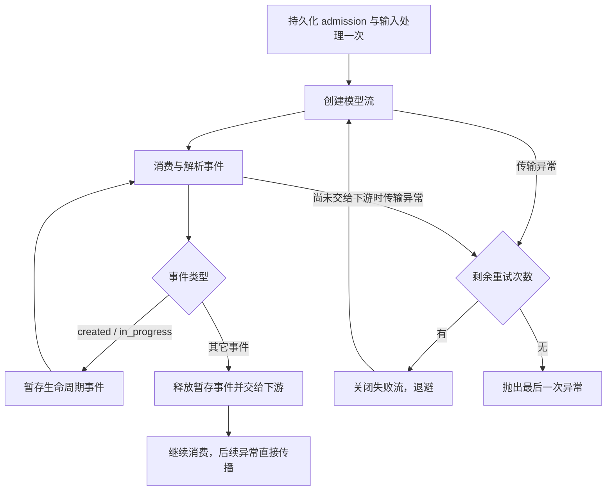

<!-- PAGE_ID: siada_17_provider-routing-retries -->

# Provider 路由与异常重试

本页按当前公开源码核对模型路由和异常处理。Provider 配置、模型协议和实际传输是三个不同选择：模型名不会自动把 `default` 改成 `li`；同一 provider 内部可以按模型名选择 Chat Completions、Responses 或 LiteLLM。

## Provider 选择

`provider_factory.resolve_provider_by_model()` 当前只做遗留 key 归一化：`openai_agents` → `li`，其它情况返回调用方指定的 provider。`get_provider()` 按目录发现实际 `ModelProvider`，未知 key 抛 `ValueError`；不应依赖目录顺序推测默认 provider。

登录页展示的 `openai`、`claude`、`gemini`、`kimi`、`glm`、`minimax` 是厂商配置目录，不等于运行时 `ModelProvider` key。端点、密钥和模型来自配置，公开默认实现是 `default`。

来源：[provider_factory.py](../../siada/provider/provider_factory.py)、[models_dev.py](../../siada/provider/models_dev.py)。

## 模型到实际协议

规则按顺序判断，GPT 主版本通过正则 `gpt-?(\d+)` 提取，版本 ≥ 5 优先进入原生 Responses。

| 场景 / 模型 | 配置 provider | 返回的模型实现 | 实际协议 / 路由 |
|---|---|---|---|
| GPT-5、GPT-5.x、GPT-6 及更新代际，包含对应 Codex 名称 | `default` | `ResponsesModel` | 原生 `/responses`，使用 `DefaultResponsesTransport` |
| 相同 GPT 代际 | `li` | `ResponsesModel` | 注入该构建提供的 Responses transport；公开协议层复用 |
| GPT-4o、DeepSeek、GLM、Kimi/Moonshot、MiniMax、普通 Chat 兼容模型 id | `default` | `DefaultOpenAIChatCompletionsModel` | 官方 agents SDK + OpenAI SDK，向配置端点发送 `/chat/completions` |
| 名字包含 `claude` / `anthropic` / `gemini` | `default` | 带兼容 mixin 的 `LitellmModel` | 保留 LiteLLM 原生厂商协议 |
| `codex-mini-latest` 等未被 GPT ≥ 5 规则命中的 Responses bridge 别名 | `default` | 带兼容 mixin 的 `LitellmModel` | `openai/responses/` bridge |
| 上述 Chat 类模型，端点为 OpenRouter | `default` | 官方 Chat 模型 | 去掉外层 `openrouter/`，保留目录中的 `vendor/model` id |
| Claude/Gemini，端点为 OpenRouter | `default` | `LitellmModel` | 添加 `openrouter/` 路由前缀，通过 OpenRouter |
| GPT、DeepSeek、Qwen、GLM、Kimi/Moonshot、MiniMax/abab 家族 | `li` | `LiOpenAIChatCompletionsModel`（公开适配器） | 官方 Chat SDK，端点解析与认证由构建注入；完整 provider 还需检查模型配置 |
| Claude/Gemini | `li` | 公开契约测试断言为 legacy `LiModel` | 私有实现的具体传输分支不在本页公开源码核验范围 |
| 自定义原生厂商命名空间，如 `bedrock/...`、`azure/...` | `default` Chat 路径 | 校验失败 | 不能只凭 LiteLLM 前缀推断 Chat 兼容端点 |

`default` 的 Chat 路径会剥离 `openai/`、`deepseek/`、`moonshot/` 等已识别的路由前缀，发送端点实际模型 id。DeepSeek/Moonshot 等非 OpenAI 路由要求配置 `BASE_URL`。`openrouter/` 模型要求匹配 OpenRouter 端点；原生 Responses 分流优先于这些 Chat 路由规则。

Li 公开 Chat 家族判断是名称包含匹配，不应据此推断任意模型都能使用。公开契约测试还验证未知模型、未配置的 `o1/o3/o4` 别名和 OpenRouter catalog id 会被拒绝。私有 provider 的完整分支及网关选择规则需要其维护者另行核验。

来源：[default_provider.py](../../siada/provider/default/default_provider.py)、[default/chat_completions.py](../../siada/provider/default/chat_completions.py)、[coverter.py](../../siada/provider/default/coverter.py)、[li/chat_completions.py](../../siada/provider/li/chat_completions.py)、[responses_model.py](../../siada/provider/responses/responses_model.py)、[公开路由契约测试](../../tests/provider/test_chat_completions_providers.py)。

## 调用场景与覆盖范围

| 入口 | 选择方式 | 本次 timeout / midstream 重试覆盖 |
|---|---|---|
| 经 `ModelProviderWrapper` / `ModelWrapper` 的 agent 模型调用 | 配置 provider，再由 provider 选择模型协议 | 覆盖所有被包装的模型实现 |
| `build_fast_run_config()` 的 fast Runner | 显式 fast 配置优先；其次可用 provider 的 fast 策略；最后主配置 | 使用同一包装器，覆盖 |
| 直接 `provider.get_model()` 后绕过包装器调用模型 | provider 自身分流 | 只有原有 provider / SDK 重试 |
| `simple_completion()` / `fast_completion()` | `client_factory` → `LLMClient.completion()` | 未经过 ModelWrapper；只有该 client / LiteLLM 原有重试 |
| 直接使用 ADK 模型 | 独立适配入口 | 未经过 ModelWrapper；未核验其私有实现 |

因此本次补齐的是统一 agent 调用边界，不宣称所有轻量 completion 或 ADK 调用都自动获得新策略。

## Catch 与重试矩阵

| 层级 | 捕获异常 | 重试机制 | 流消费阶段 |
|---|---|---|---|
| 新增 ModelWrapper 外层 | Python `TimeoutError`；OpenAI `APIConnectionError`（包含 `APITimeoutError`）；HTTPX `TimeoutException`、`NetworkError`、`RemoteProtocolError`；LiteLLM `Timeout`、`APIConnectionError`、`MidStreamFallbackError` | 最多重试 2 次，共 3 次模型调用；等待 `1 + jitter`、`2 + jitter` 秒，jitter 为 0～1 秒 | 同时包住创建流、首次迭代、之后的解析/迭代；只在尚未暴露非生命周期事件时重试 |
| default 官方 Chat client | `max_retries=0` | SDK 自动重试关闭；由包装器处理上述传输错误 | SDK 创建请求之外的读流错误由包装器捕获 |
| Li 官方 Chat 原有策略 | `RateLimitError` | 指数退避、上限和抖动；次数由构建提供的常量控制 | 首个事件之前可重试；产出任何事件之后直接抛出 |
| Li 官方 Chat 原有认证策略 | `APIStatusError` 且 HTTP 401/403 | 刷新认证后重试；有独立认证次数和总请求次数限制 | 首个事件之前可重试；之后直接抛出 |
| Li 官方 Chat client | `max_retries=0` | SDK 自动重试关闭，保留上面两类 provider 重试 | 外层包装器另外补齐传输异常 |
| default Responses transport | `except Exception` 记录错误后重新抛出 | 未显式覆盖 OpenAI SDK 默认重试参数 | 创建流后的异常不在 transport 的创建调用 catch 内；包装器消费模型流时捕获 |
| `ResponsesModel` | `except Exception` 记录错误后重新抛出 | 自身不重试 | 模型的事件解析/迭代异常交给外层包装器 |
| default legacy LiteLLM | 启动配置 `litellm.num_retries=3` | LiteLLM 负责其支持的异常与退避；不能把设置值当作每类异常必重试的承诺 | SDK/LiteLLM 返回流对象之后，解析抛出的传输类异常由外层包装器补齐 |
| 新增外层的其它异常 | 其它 HTTP 状态错误、普通 `ValueError` / JSON 解析错误 | 直接抛出，保留原有内层处理 | 不把任意解析 bug 当作断流重试 |
| 取消 | `asyncio.CancelledError` | 不捕获为可重试异常；关闭当前流 | 立即传播取消 |

Li 原有 429 和认证次数常量来自构建提供的模块；公开适配器能核验 catch 条件、退避公式和总请求上限表达式，但本页不猜测私有常量具体值。外层传输重试重新调用模型，Li 的请求 UUID 会重新生成；一次内层 429/认证重试则保留其请求 UUID 和去重标识。

重试预算分层，不能把“最多 3 次模型调用”解释为“最多 3 次 HTTP 请求”。例如内层一次模型调用自身最多发 N 次请求，外层最坏可以发到 `3 × N` 次。原生 default Chat 内层 SDK 重试关闭；Responses SDK 和 LiteLLM 的内层策略继续生效。

来源：[retry.py](../../siada/provider/retry.py)、[model_wrapper.py](../../siada/services/model_wrapper.py)、[li/chat_completions.py](../../siada/provider/li/chat_completions.py)、[responses_transport.py](../../siada/provider/default/responses_transport.py)、[LiteLLM 启动配置](../../siada/entrypoint/__init__.py)。

模型流正常 EOF 但缺少终止响应事件时，统一包装器与 `ResponsesModel` 会抛出
`MissingFinalResponseError`，记录模型、response ID、最后事件和内容暴露状态。
只收到 `response.created` / `response.in_progress` 或空流时沿用最多两次重试；
已经交出正文、推理或工具事件时直接失败。明确的 `response.incomplete` /
`response.failed` 保留原有失败处理，不归类为缺失终止事件。泛化的
`ModelBehaviorError` 不自动重试。

## Timeout 与 midstream 的阶段边界



例如第一次请求产出 `response.created` 后，在读取首个 chunk 时抛 `ReadTimeout` 或 `MidStreamFallbackError`，外层会关闭失败流、丢弃暂存的 created、退避并重建模型流。下游只收到成功尝试的生命周期事件与内容。

一旦 `response.output_item.added`、文本 delta、reasoning delta、工具参数 delta 或其它非生命周期事件已经交给下游，就停止重放。此时重新请求可能返回不同内容和工具 id；仅在 provider 内重试会重复输出，工具执行还可能重复。没有协议级撤回或恢复契约时，异常会保留并交由上层处理。

普通解析 `ValueError` 不在传输异常白名单中；“解析过程中抛异常”需要区分读取断流与数据格式错误。流正常结束而没有抛异常也不会被本策略当成 timeout。`response.incomplete` 等正常协议事件不等同于网络异常。

持久化 admission 和输入处理在重试循环外，重试沿用处理后的同一输入。admission 本身的 timeout 不触发模型调用。`ModelWrapper` 嵌套时由最内层包装器拥有传输重试预算，各层 admission / 输入处理仍各执行一次，避免重试次数相乘。失败流在退避前关闭，调用方关闭生成器或取消时也执行清理。

## 超时参数

default 和 Li 官方 Chat client 显式设置 `LLM_API_POST_TIMEOUT = 1200` 秒，并设置 SDK `max_retries=0`。default Responses client 当前未显式设置 timeout / max_retries，使用锁定版本 SDK 默认参数。LiteLLM 路径的实际 timeout 取决于对应调用参数；不能把 Chat 的 1200 秒配置推导为所有 provider 的超时。

HTTP 客户端 timeout 通常限制单次连接/读取等操作，外层重试不提供总 wall-clock 截止时间。内层重试再叠加外层重试，整体耗时可能显著长于单次 timeout。

来源：[constants.py](../../siada/foundation/constants.py)、[default/chat_completions.py](../../siada/provider/default/chat_completions.py)、[responses_transport.py](../../siada/provider/default/responses_transport.py)。

## 回归验证

新增 [传输重试测试](../../tests/services/test_model_wrapper_transport_retry.py) 验证创建流立即失败、首个事件之前失败、生命周期事件之后解析失败、已暴露内容/工具事件后不重放、重试耗尽、取消、资源关闭、admission 只执行一次，以及真实 OpenAI Chat SDK 读 SSE body 时抛 timeout 后成功重试且只显示一次内容。

真实 `Runner.run_streamed()` 配合官方 Chat SDK 和合成 SSE 传输进一步验证：首读超时后最终得到一次完整响应；连续超时在三次模型调用后向 turn 层传播；已交出文本后的超时不重放，旧流均关闭。这些故障注入不访问外部模型服务。

```bash
poetry run python -m pytest tests/services/test_model_wrapper_transport_retry.py tests/session/baseline/test_model_request_boundary.py -q
```
