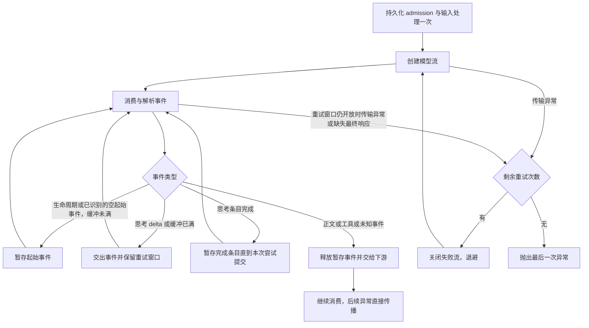

<!-- PAGE_ID: siada_17_provider-routing-retries -->

# Provider 路由与异常重试

本页按当前公开源码核对模型路由和异常处理。Provider 配置、模型协议和实际传输是三个不同选择：模型名不会改变 provider 选择；`default` provider 内部按模型名选择 Chat Completions、Responses 或 LiteLLM。

## Provider 选择

`provider_factory.resolve_provider_by_model()` 当前直接返回调用方指定的 provider。`get_provider()` 按目录发现实际 `ModelProvider`，未知 key 抛 `ValueError` 并列出可用 provider；未指定时返回第一个发现的 provider，不应依赖目录顺序推测默认 provider。

登录页展示的 `openai`、`claude`、`gemini`、`kimi`、`deepseek`、`glm`、`minimax` 是厂商配置目录，不等于运行时 `ModelProvider` key。端点、密钥和模型来自配置，公开默认实现是 `default`。

来源：[provider_factory.py](../../siada/provider/provider_factory.py)、[models_dev.py](../../siada/provider/models_dev.py)。

## 模型到实际协议

规则按顺序判断，GPT 主版本通过正则 `gpt-?(\d+)` 提取，版本 ≥ 5 优先进入原生 Responses。

| 场景 / 模型 | 配置 provider | 返回的模型实现 | 实际协议 / 路由 |
|---|---|---|---|
| GPT-5、GPT-5.x、GPT-6 及更新代际，包含对应 Codex 名称 | `default` | `ResponsesModel` | 原生 `/responses`，使用 `DefaultResponsesTransport` |
| GPT-4o、DeepSeek、GLM、Kimi/Moonshot、MiniMax、普通 Chat 兼容模型 id | `default` | `DefaultOpenAIChatCompletionsModel` | 官方 agents SDK + OpenAI SDK，向配置端点发送 `/chat/completions` |
| 名字包含 `claude` / `anthropic` / `gemini` | `default` | 带兼容 mixin 的 `LitellmModel` | 保留 LiteLLM 原生厂商协议 |
| `codex-mini-latest` 等未被 GPT ≥ 5 规则命中的 Responses bridge 别名 | `default` | 带兼容 mixin 的 `LitellmModel` | `openai/responses/` bridge |
| 上述 Chat 类模型，端点为 OpenRouter | `default` | 官方 Chat 模型 | 去掉外层 `openrouter/`，保留目录中的 `vendor/model` id |
| Claude/Gemini，端点为 OpenRouter | `default` | `LitellmModel` | 添加 `openrouter/` 路由前缀，通过 OpenRouter |
| 自定义原生厂商命名空间，如 `bedrock/...`、`azure/...` | `default` Chat 路径 | 校验失败 | 不能只凭 LiteLLM 前缀推断 Chat 兼容端点 |

`default` 的 Chat 路径会剥离 `openai/`、`deepseek/`、`moonshot/` 等已识别的路由前缀，发送端点实际模型 id。DeepSeek/Moonshot 等非 OpenAI 路由要求配置 `BASE_URL`。`openrouter/` 模型要求匹配 OpenRouter 端点；原生 Responses 分流优先于这些 Chat 路由规则。

公开契约测试验证原生厂商协议前缀和 LiteLLM 专有命名空间会被拒绝、厂商路由缺 `BASE_URL` 会报错，以及 OpenRouter 模型 id 的映射关系。

来源：[default_provider.py](../../siada/provider/default/default_provider.py)、[default/chat_completions.py](../../siada/provider/default/chat_completions.py)、[coverter.py](../../siada/provider/default/coverter.py)、[responses_model.py](../../siada/provider/responses/responses_model.py)、[公开路由契约测试](../../tests/provider/test_chat_completions_providers.py)。

## 调用场景与覆盖范围

| 入口 | 选择方式 | 本次 timeout / midstream 重试覆盖 |
|---|---|---|
| 经 `ModelProviderWrapper` / `ModelWrapper` 的 agent 模型调用 | 配置 provider，再由 provider 选择模型协议 | 覆盖所有被包装的模型实现 |
| `build_fast_run_config()` 的 fast Runner | 显式 `fast_llm_config` 优先；否则主配置 | 使用同一包装器，覆盖 |
| 直接 `provider.get_model()` 后绕过包装器调用模型 | provider 自身分流 | 只有原有 provider / SDK 重试 |
| `simple_completion()` / `fast_completion()` | `client_factory` → `LLMClient.completion()` | 未经过 ModelWrapper；只有该 client / LiteLLM 原有重试 |

因此本次补齐的是统一 agent 调用边界，轻量 completion 保留自身原有重试。

## Catch 与重试矩阵

| 层级 | 捕获异常 | 重试机制 | 流消费阶段 |
|---|---|---|---|
| 新增 ModelWrapper 外层 | Python `TimeoutError`；OpenAI `APIConnectionError`（包含 `APITimeoutError`）；HTTPX `TimeoutException`、`NetworkError`、`RemoteProtocolError`；LiteLLM `Timeout`、`APIConnectionError`、`MidStreamFallbackError`；OpenAI API 错误（HTTP 403/408/409/429/5xx、已识别的服务端/过载/限流/超时错误码、未分类的 `Unknown stream error`） | 最多重试 2 次，共 3 次模型调用；等待 `1 + jitter`、`2 + jitter` 秒，jitter 为 0～1 秒 | 同时包住创建流、首次迭代、之后的解析/迭代；正文、工具或未知事件交给下游后不重放 |
| default 官方 Chat client | `max_retries=0` | SDK 自动重试关闭；由包装器处理上述传输错误 | SDK 创建请求之外的读流错误由包装器捕获 |
| default Responses transport | `except Exception` 记录错误后重新抛出 | 原生 SDK `max_retries=0`，由包装器管理预算 | 创建流后的异常不在 transport 的创建调用 catch 内；包装器消费模型流时捕获 |
| `ResponsesModel` | `except Exception` 记录错误后重新抛出 | 自身不重试 | 模型的事件解析/迭代异常交给外层包装器 |
| default legacy LiteLLM | 启动配置 `litellm.num_retries=3` | LiteLLM 负责其支持的异常与退避；不能把设置值当作每类异常必重试的承诺 | SDK/LiteLLM 返回流对象之后，解析抛出的传输类异常由外层包装器补齐 |
| 新增外层的其它异常 | 其它 HTTP 状态错误、普通 `ValueError` / JSON 解析错误、流中的参数或配额错误码 | 直接抛出，保留原有内层处理 | 不把任意解析 bug 当作断流重试 |
| 取消 | `asyncio.CancelledError` | 不捕获为可重试异常；关闭当前流 | 立即传播取消 |

重试预算分层，不能把“最多 3 次模型调用”解释为“最多 3 次 HTTP 请求”。例如内层一次模型调用自身最多发 N 次请求，外层最坏可以发到 `3 × N` 次。原生 default Chat 和 Responses 内层 SDK 重试关闭；其它调用路径的 provider 策略需要分别核对。

HTTP 403（包括 `PermissionDeniedError` 认证失败）也使用外层的两次重试额度；
503 后遇到 403 不会重置预算，连续失败仍抛出最后一次异常。
外层只重新调用模型，不负责刷新认证凭证，HTTP 401 仍不在外层重试范围内。

子 Agent 的 `run_subtask_impl()` 另有最多两次运行恢复，也使用
`is_retryable_model_error()` 判断 HTTP 403。它在模型层预算耗尽后从已提交历史继续；
连续 403 且没有其它重试时，最多三轮运行各调用模型三次，共九次模型调用。
其它 provider 自身可能的 HTTP 重试需要另行计入。已完成的工具结果保留在历史中。

来源：[retry.py](../../siada/provider/retry.py)、[model_wrapper.py](../../siada/services/model_wrapper.py)、[responses_transport.py](../../siada/provider/default/responses_transport.py)、[LiteLLM 启动配置](../../siada/entrypoint/__init__.py)。

模型流正常 EOF 但缺少终止响应事件时，统一包装器与 `ResponsesModel` 会抛出
`MissingFinalResponseError`，记录模型、response ID、最后事件和内容暴露状态。
只收到生命周期、空起始事件或思考内容时沿用最多两次重试；
已经交出正文、工具或未知事件时直接失败。明确的 `response.incomplete` /
`response.failed` 保留原有失败处理，不归类为缺失终止事件。泛化的
`ModelBehaviorError` 不自动重试。

## Timeout 与 midstream 的阶段边界



例如第一次请求产出 `response.created` 后，在读取首个 chunk 时抛 `ReadTimeout` 或 `MidStreamFallbackError`，外层会关闭失败流、丢弃暂存的 created、退避并重建模型流。下游只收到成功尝试的生命周期事件与内容。

空的 assistant message / reasoning `response.output_item.added`、空的
`response.content_part.added` 和 `response.reasoning_summary_part.added` 会与生命周期事件
一起暂存，最多 64 个事件。在这些起始事件之后发生 `RemoteProtocolError`
（包括服务发版导致的 `incomplete chunked read`）仍可关闭旧流并退避重试，
丢弃失败尝试的 response ID 和 item ID。

思考 delta 实时输出，思考条目和片段事件也保留重试窗口；下一次尝试可能显示新的
思考内容。起始事件缓冲已满时只释放缓冲，不关闭重试窗口。思考输出后的新
`response.created` 会结束上一段 thinking 展示并使用新的消息 ID。

思考条目的完成事件暂存到本次尝试提交时才交出，失败尝试的完成条目会被丢弃，
避免 Runner 在最终输出为空时将其补齐进会话历史。一旦正文、工具调用条目或参数、
未知事件交给下游，就停止重放；此时异常交由上层处理，避免重复正文和工具执行。

普通解析 `ValueError` 不在传输异常白名单中；“解析过程中抛异常”需要区分读取断流与数据格式错误。流正常结束而没有抛异常也不会被本策略当成 timeout。`response.incomplete` 等正常协议事件不等同于网络异常。

`ResponsesModel` 将协议 `error`、`response.error`、`response.failed` 转成 `APIError` 后交给同一策略，避免把失败事件当成功流结束。流错误优先按明确的 `code` 判断，其次按 `type`；没有分类字段时才匹配 `Unknown stream error`。因此明确的参数错误或配额不足不会因消息包含该文案而重试。

每次 Responses 失败记录模型、response ID、最后事件类型、是否已交出正文、工具或未知事件，以及有长度限制的错误 message/code/type/param、可用的请求和 trace ID。仅思考已输出时，`output_exposed` 仍为 False。仅提取这些诊断字段，不打印完整错误 body、请求正文或认证请求头。重试日志记录次数、等待时间和错误诊断字段。

持久化 admission 和输入处理在重试循环外，重试沿用处理后的同一输入。admission 本身的 timeout 不触发模型调用。`ModelWrapper` 嵌套时由最内层包装器拥有传输重试预算，各层 admission / 输入处理仍各执行一次，避免重试次数相乘。失败流在退避前关闭，调用方关闭生成器或取消时也执行清理。

## 超时参数

default 官方 Chat client 显式设置 `LLM_API_POST_TIMEOUT = 1200` 秒，并设置 SDK `max_retries=0`。default Responses client 设置 SDK `max_retries=0`，timeout 使用锁定版本 SDK 默认参数。LiteLLM 路径的实际 timeout 取决于对应调用参数；不能把 Chat 的 1200 秒配置推导为所有 provider 的超时。

HTTP 客户端 timeout 通常限制单次连接/读取等操作，外层重试不提供总 wall-clock 截止时间。内层重试再叠加外层重试，整体耗时可能显著长于单次 timeout。

来源：[constants.py](../../siada/foundation/constants.py)、[default/chat_completions.py](../../siada/provider/default/chat_completions.py)、[responses_transport.py](../../siada/provider/default/responses_transport.py)。

## 回归验证

新增 [传输重试测试](../../tests/services/test_model_wrapper_transport_retry.py) 验证创建流立即失败、首个事件之前失败、生命周期事件之后解析失败、已暴露内容/工具事件后不重放、重试耗尽、取消、资源关闭、admission 只执行一次，以及真实 OpenAI Chat SDK 读 SSE body 时抛 timeout 后成功重试且只显示一次内容。

真实 `Runner.run_streamed()` 配合官方 Chat SDK 和合成 SSE 传输进一步验证：首读超时后最终得到一次完整响应；连续超时在三次模型调用后向 turn 层传播；已交出文本后的超时不重放，旧流均关闭。这些故障注入不访问外部模型服务。

原生 Responses SDK + Runner 的合成 SSE 回归覆盖 `Unknown stream error` 恢复、三次调用后耗尽、正文后不重放、明确参数错误不重试、协议失败事件重试、流关闭和错误日志字段筛选。

```bash
poetry run python -m pytest tests/services/test_model_wrapper_transport_retry.py tests/session/baseline/test_model_request_boundary.py -q
```