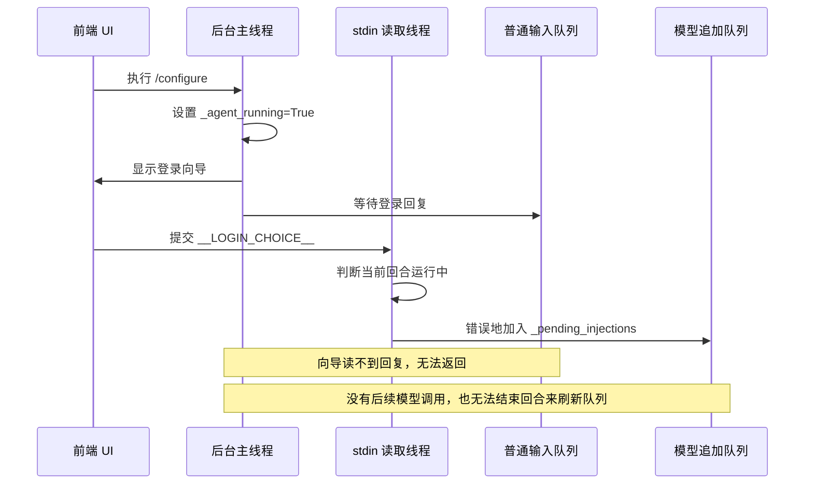
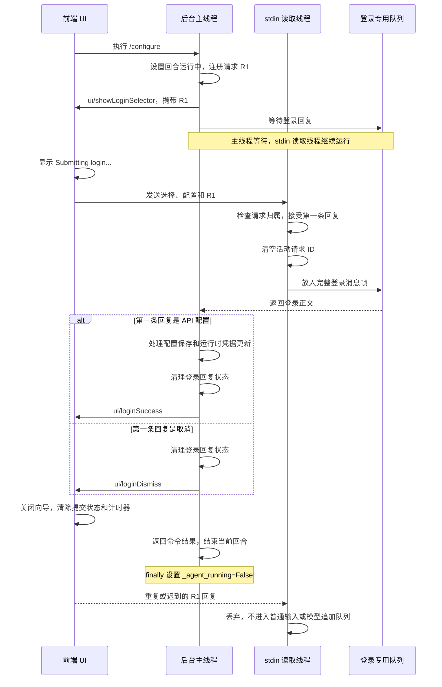

# API 重复配置卡在 Submitting login 的排查与修复

本文解释 Siada CLI 在执行 `/configure` 时，为什么可能一直停在
`Submitting login... (Esc to cancel)`，以及登录回复如何从前端到达后台配置向导。
内容依据当前源码，覆盖消息路由、请求归属、取消行为和前端状态恢复。

## 1. 问题现象

首次配置 API 后，再次执行 `/configure`，选择供应商、模型并提交 API Key，
界面可能一直显示：

```text
Submitting login... (Esc to cancel)
```

原始问题发生在 v1.7.31 的重复配置场景。核心原因是登录回复进入了模型追加
队列，而配置向导等待的是另一个输入队列。

进一步验证还发现两个关联问题：

- 提交后再按 Esc，会发送第二条登录回复。如果所有回复都进入普通输入队列，
  后续回复可能残留到聊天输入或下一次配置。
- 后台取消完成后发送 `ui/loginDismiss`，前端适配器原先没有识别这条通知，
  导致后台回合已经结束，登录界面仍然显示。

## 2. 先区分进程、线程和状态

| 执行位置 | 职责 | 配置提交时的状态 |
| --- | --- | --- |
| 前端 UI 进程 | React/Ink 显示向导，向后台 stdin 写入选择 | 显示提交状态，等待后台通知 |
| 后台主线程 | 执行命令回合，调用配置向导，保存配置 | 等待登录回复 |
| 后台 stdin 读取线程 | 持续读取字节，组装消息，分流到队列 | 继续工作，不受主线程等待影响 |

前端的 `isSubmittingLogin` 和后台的 `_agent_running` 是不同的状态。

`isSubmittingLogin` 控制界面是否显示提交中、是否拦截重复提交。
`_agent_running=True` 表示当前回合还在执行；命令回合也会设置这个标记。
它不能用于判断当前是否正在调用模型。

调用链可以按以下顺序理解：

```text
Controller
  → TurnPolicy.execute()
      → set_agent_running(True)
      → CommandTurn.execute()
          → cmd_configure()
              → reconfigure_acp()
                  → 显示登录向导
                  → 等待登录回复
                  → 保存配置或取消
      → finally: set_agent_running(False)
```

主线程进入配置向导的等待循环时，`_agent_running` 仍然为 `True`。

## 3. 修复前为什么会一直等待

前端提交的登录回复以 `__LOGIN_CHOICE__:` 开头。
原先 stdin 读取线程没有先区分这类控制回复，而是按运行中的普通用户消息处理。



这里形成了一个等待循环：

```text
向导返回
  → 当前回合结束
  → 未消费的追加消息回到普通队列
  → 向导才能读到回复
  → 向导返回
```

stdin 读取线程实际上已经读到了消息，问题出在消息分流。
此外，登录回复包含 API 配置，把它作为聊天内容追加给模型也会破坏凭据边界。

## 4. 从提前分流到完整的登录回复生命周期

第一轮修复先识别 `__LOGIN_CHOICE__:`，将完整消息送回普通输入队列，
然后立即 `return`，跳过模型追加逻辑。这解除了原始等待循环。

但一次向导只读取一条回复。若随后又收到取消或重复提交，普通输入队列里仍可能
残留登录消息。因此最终实现增加了专用队列和请求归属检查。

以下以 stdin 监控器启用的 ACP 路径为例；未启用监控器时，
向导仍保留直接读取 stdin 的旧路径。

| 队列 | 接收内容 | 消费位置 |
| --- | --- | --- |
| `_queue` | 普通用户输入 | 主交互输入循环 |
| `_pending_injections` | 回合运行中追加的普通聊天内容 | 模型调用前的输入处理器；未消费内容在回合结束时回到普通队列 |
| `_login_reply_queue` | 被当前向导接受的一条登录回复 | `_read_acp_stdin_message()` 通过 `read_login_reply_line()` 读取 |

### 4.1 先注册请求，再显示向导

`_send_acp_notification()` 发送 `ui/showLoginSelector` 前，先调用
`begin_login_request()`：

1. 清理上一次未读的登录回复。
2. 生成新的请求 ID。
3. 将它加入显示通知的 `params.requestId`。
4. 再把通知发送给前端。

这个顺序保证前端快速回复时，后台已经准备好接收本次请求。

### 4.2 前端把请求 ID 带回后台

新协议保留原来的消息前缀，第三段使用 JSON 封装。
下面的 Key 和请求 ID 均为合成示例：

```text
<<<SIADA_MSG_START>>>
__LOGIN_CHOICE__:3:{"requestId":"example-request-1","payload":"{\"provider_id\":\"kimi\",\"model\":\"kimi-k3\",\"api_key\":\"sk-synthetic-example\",\"base_url\":\"https://example.test/v1\"}"}
<<<SIADA_MSG_END>>>
```

其中 `payload` 是配置 JSON 的字符串。取消回复使用同一个请求 ID，
并把 `payload` 设置为 `null`：

```text
__LOGIN_CHOICE__:cancel:{"requestId":"example-request-1","payload":null}
```

后台检查封装中的字段类型和请求 ID，接受后再恢复成旧的登录正文格式，
交给现有配置解析器处理。

### 4.3 在锁内只接受第一条匹配回复

`_dispatch_or_enqueue()` 在普通消息分流之前处理登录回复：

1. 当前没有活动向导时，丢弃回复。
2. 回复携带的请求 ID 与活动请求不一致时，丢弃回复。
3. 第一条匹配回复被接受后，立即清空活动请求 ID。
4. 把消息帧放入登录专用队列，然后 `return`。

检查、关闭接收窗口和入队在同一个登录回复锁内完成。
因此两条回复同时到达时，也只有一条能够被本次向导接受。

### 4.4 结束时清理未读回复

`finish_login_request()` 清空活动请求 ID，并清理登录专用队列。
成功、错误、取消通知，以及监控器停止时都会触发清理；
显示向导的通知发送失败时也会关闭接收窗口。

这还覆盖了“回复已经被接受，但主线程尚未读取就被中断”的窗口，
避免未读配置消息留到后续交互。

## 5. 修复后的完整时序

下图简化了 `/configure` 自身的普通输入入队过程，重点展示登录回复通道。



API 配置成功后，命令还会按现有逻辑返回切换事件，由 Controller 处理后续
运行配置切换。`ui/loginSuccess` 与这段后续处理不是同一个事件。

## 6. 提交、取消和界面恢复的语义

| 场景 | 后台行为 | 前端结果 |
| --- | --- | --- |
| API 提交先被接受，随后按 Esc | 处理已接受的提交，忽略后到的取消 | 等待提交结果；Esc 不撤销已接受的配置 |
| 取消先被接受，随后又收到提交 | 返回取消结果，忽略后到的提交 | 关闭向导，不执行此次配置保存 |
| 新向导 R2 打开后，旧回复 R1 到达 | ID 不匹配，丢弃 R1；R2 仍可接收回复 | 新向导继续正常工作 |
| 回复已入队但读取前退出向导 | 清理未读登录队列 | 后续聊天和配置不会消费遗留回复 |
| 前端写入 stdin 完成 | 仅表示消息发送完成 | 仍需等待后台成功、错误或取消通知 |

`sendLoginChoice()` 的 Promise 完成不代表配置已经成功。
前端根据后台通知完成状态切换。

前端原先仅把 `ui/loginError` 和 `ui/loginCancelled` 转为内部
`ui:loginDismiss` 事件。本次增加了对实际后台通知 `ui/loginDismiss` 的识别，
这样取消结果才能到达 `useAcp` 的事件处理器并关闭登录界面。

`App` 还使用新的请求 ID 重置提交状态、错误提示和 watchdog。
即使旧向导关闭与新向导打开被 React 合并到同一次渲染，
界面阶段仍是 `selecting`，也能通过请求 ID 的变化识别新向导。

watchdog 超时只会恢复前端输入能力，不能解除后台的队列等待；
原始死锁由正确分流登录回复解决。

### 兼容旧协议的边界

新前端在后台未提供请求 ID 时，仍发送旧格式；
新后台在活动向导期间，仍接受旧客户端的第一条无 ID 回复。

无 ID 的旧格式无法精确区分“上一向导的延迟回复”和“当前向导的回复”。
跨向导的请求归属保护依赖双方使用新的请求 ID 协议。

## 7. 源码导航

| 文件 | 建议阅读的入口 |
| --- | --- |
| [controller.py](../../../siada/entrypoint/interaction/controller.py) | 创建回合、执行策略、处理切换事件 |
| [turn_policy.py](../../../siada/entrypoint/interaction/turn_policy.py) | `execute()` 中的运行标记及 `finally` 清理 |
| [command_turn.py](../../../siada/entrypoint/interaction/turn/command_turn.py) | 命令回合执行 |
| [slash_commands.py](../../../siada/support/slash_commands.py) | `cmd_configure()` |
| [login_prompt.py](../../../siada/entrypoint/login/login_prompt.py) | `_send_acp_notification()`、`_read_acp_stdin_message()`、`reconfigure_acp()` |
| [stdin_interrupt_monitor.py](../../../siada/io/stdin_interrupt_monitor.py) | `begin_login_request()`、`finish_login_request()`、`read_login_reply_line()`、`_dispatch_or_enqueue()` |
| [pending_user_input_filter.py](../../../siada/agent_hub/context_filter/pending_user_input_filter.py) | 模型调用前消费普通追加消息 |
| [client.ts](../../../siada_cli_ui/src/acp/client.ts) | `sendLoginChoice()` 封装回复 |
| [adapter.ts](../../../siada_cli_ui/src/acp/adapter.ts) | 识别登录通知、发送 stdin 输入 |
| [events/index.ts](../../../siada_cli_ui/src/hooks/useAcp/events/index.ts) | 保存请求 ID，处理成功和取消事件 |
| [types.ts](../../../siada_cli_ui/src/hooks/useAcp/types.ts) | 登录状态的 `requestId` 字段 |
| [App.tsx](../../../siada_cli_ui/src/components/App.tsx) | `handleLoginSelect()`、提交状态与 watchdog |

## 8. 验证记录与复查步骤

本次修复验证记录（2026-10-15）：

| 验证项 | 结果 |
| --- | --- |
| 相关 Python 回归测试 | 48 项通过 |
| 前端提交、协议与适配器测试 | 20 项通过 |
| TypeScript 检查与 UI bundle 构建 | 通过 |
| Wheel 构建和安装产物核对 | 通过，安装版与本次测试 wheel 一致 |
| 真机 Terminal 配置交互 | 下列五个场景通过 |

真机验证使用实际安装的 UI 和 Python 后端，并使用合成 Key、测试模型列表与
隔离配置目录。验证范围为配置和交互链路，没有调用真实供应商模型 API。

| 场景 | 操作 | 通过条件 |
| --- | --- | --- |
| 首次配置 | 启动后配置 Kimi | 收到成功通知，保存的供应商和 Key 正确 |
| 重复配置 | 再次执行 `/configure`，提交新 Key；提交中按 Esc | 已接受的提交完成，后续取消不影响下一向导 |
| 切换供应商 | 配置 OpenAI | 保存字段实际变为 OpenAI，向导正常返回 |
| 取消配置 | 执行 `/configure` 后按 Esc | 收到取消通知，登录界面关闭 |
| 取消后再次配置 | 再次执行 `/configure`，配置 Kimi | 向导重新打开并成功保存，不受旧回复影响 |

相关日志未出现登录提交 watchdog 超时、登录回复进入模型追加队列、
合成测试 Key 泄露或异常堆栈。该结论针对配置链路，不表示所有启动日志都无告警。

开发环境中可从仓库根目录复查相关回归测试：

```bash
poetry run python -m pytest \
  tests/io/test_pending_injection_queue.py \
  tests/entrypoint/test_reconfigure_acp.py \
  tests/entrypoint/interaction/test_turn_policy.py -q

npm --prefix siada_cli_ui test -- --run \
  tests/login-submission.test.tsx \
  tests/login-protocol.test.ts \
  src/acp/__tests__/adapter.test.ts

npm --prefix siada_cli_ui run build -- --noEmit
```

通过标准还包括：普通输入不会被向导消费；重复及过期回复不会进入普通队列；
结束向导时会清理已接受但未读的登录回复；新协议的配置内容不会被写入日志。

使用标准启动器验证 UI 源码修改前，应重新构建 bundle：

```bash
npm --prefix siada_cli_ui run build:all
```

安装新版本后，重新启动 CLI 进程以加载新代码。操作说明见
[外部模型配置指南](../../zh-CN/external_model_configuration_zh.md)。
