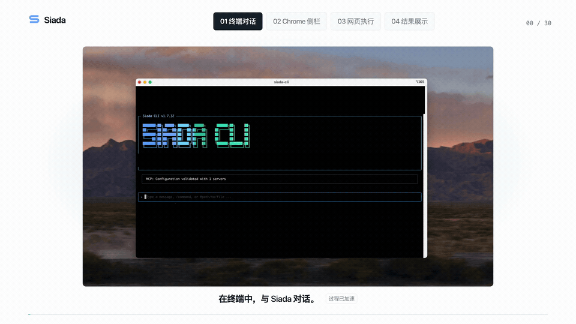
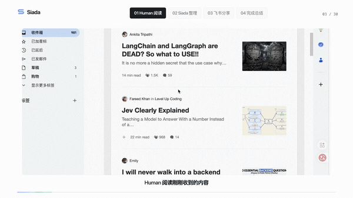
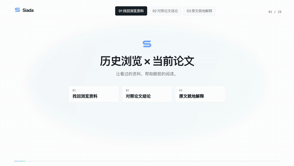
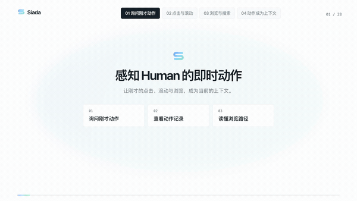
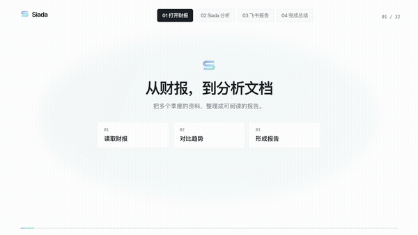
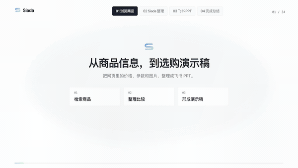
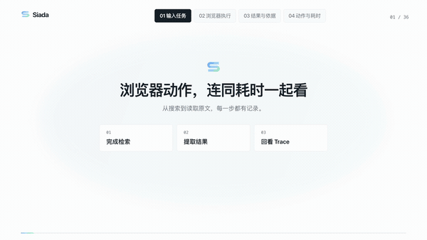

# Siada CLI

**简体中文 | [English](../../README.md)**

[](https://pypi.org/project/siada-cli/)
[](https://www.python.org/downloads/)
[](../../LICENSE)

**Siada CLI 是用于编程、调试和自动化的 AI 助手。** 它结合项目上下文、工具与持续记忆，推动任务从调查、实现走到验证。它也能控制浏览器，并从你当前的阅读和近期操作中感知你的意图。

[News](#news) · [主要能力](#主要能力) · [快速开始](#快速开始) · [浏览器协作预览](#浏览器协作预览) · [文档](#文档)

[](../assets/demos/siada-chrome-home-desktop-v2.mp4?raw=1)

[浏览器协作展示页与使用手册](https://liauto-siada.github.io/siada-cli/)。展示页也提供返回 GitHub 仓库的入口。

## News

### Siada: Human in browser use

> AI 的价值不是取代，而是营造创造的环境。

**浏览器协作：** PyPI 包包含浏览器安装器；配套 Node.js、代理和 Chrome 扩展通过 GitHub Releases 的对应版本平台包分发。以下工作流来自浏览器协作演示；生成飞书产物需要相关技能与授权。

浏览器协作预览让 Siada 进入你正在阅读的页面。当前阅读、浏览历史与即时动作都能成为上下文，一起理解、整理，让眼前的信息继续成为作品。

**用户意图感知。** 找回你浏览过的论文、GitHub 项目与文章，与当前页面对照。读取已经记录的点击、滚动与页面跳转，回答“我刚才做了什么”。

**利于创造的环境营造。** 翻译、解释与比较直接出现在对应段落旁；通过已经配置的技能与集成，把网页信息继续整理成报告、演示稿、网页或小工具。

**高效的浏览器操作。** 连续完成搜索、导航与信息提取，通过 Trace 回看动作快照、每步工具执行耗时和调用间隔，检查任务执行过程。

| 场景 | 案例结果 | 完整视频 |
| --- | --- | --- |
| 当前阅读 → 飞书分享 | 整理每日文章精选，保留原文链接，分享到学习群。 | [▶ 30 秒](../assets/demos/siada-reading-to-feishu.mp4?raw=1) |
| 浏览历史 → 论文对照 | 找回相关研究，对照 survey 的五条关键结论，把解释与比较放回原文。 | [▶ 28 秒](../assets/demos/siada-history-to-paper.mp4?raw=1) |
| 即时动作 → 浏览路径 | 将记录的点击、滚动、搜索与页面跳转整理为可读的回复。 | [▶ 28 秒](../assets/demos/siada-human-action-perception.mp4?raw=1) |
| 当前网页 → 就地解释 | 在对应段落旁展示翻译、批注和比较。 | [▶ 28 秒](../assets/demos/siada-history-to-paper.mp4?raw=1) |
| 经济财报 → 飞书报告 | 对照季度与年度收入、毛利率和现金流，把分析、图表与来源整理成文档。 | [▶ 32 秒](../assets/demos/siada-financial-report.mp4?raw=1) |
| 电商信息 → 演示稿 | 收集商品图片与参数，比较价格和特性，将选购建议整理成飞书演示稿。 | [▶ 34 秒](../assets/demos/siada-ecommerce-to-ppt.mp4?raw=1) |
| 浏览器检索 → Trace 回看 | 在 GitHub 项目的 `pyproject.toml` 中查找 Agent 相关依赖、版本与来源，再检查动作与耗时。 | [▶ 36 秒](../assets/demos/siada-browser-control-trace.mp4?raw=1) |

点击动图预览可打开完整 MP4。六支演示均为无声视频，配有中文画面字幕；论文对照视频同时展示原文就地解释。

| 阅读 → 飞书分享 · 30 秒 | 历史浏览 → 论文对照 · 28 秒 |
| --- | --- |
| [](../assets/demos/siada-reading-to-feishu.mp4?raw=1) | [](../assets/demos/siada-history-to-paper.mp4?raw=1) |

| 即时动作 → 上下文 · 28 秒 | 财报分析 → 飞书报告 · 32 秒 |
| --- | --- |
| [](../assets/demos/siada-human-action-perception.mp4?raw=1) | [](../assets/demos/siada-financial-report.mp4?raw=1) |

| 电商信息 → 演示稿 · 34 秒 | 浏览器检索 → Trace · 36 秒 |
| --- | --- |
| [](../assets/demos/siada-ecommerce-to-ppt.mp4?raw=1) | [](../assets/demos/siada-browser-control-trace.mp4?raw=1) |

集成概览见[浏览器协作预览](#浏览器协作预览)，正式发布版本见 [Releases](https://github.com/liauto-siada/siada-cli/releases) 与 [PyPI](https://pypi.org/project/siada-cli/)。

## 主要能力

| 能力 | 可以完成的工作 |
| --- | --- |
| 代码开发与调试 | 理解仓库、实现功能、修复问题，并运行相关检查，支持多种语言和框架。 |
| 长任务与子智能体 | 规划复杂工作，把边界明确的任务交给专业子智能体，并跟踪目标进度。 |
| 模型选择 | 使用不同模型系列，通过 Provider 层配置自定义 API 服务。 |
| 持续记忆 | 跨会话保留偏好、项目背景和决策，通过结构化事实库检索与反馈。 |
| Skills、Agents 与 MCP | 增加可复用工作流、专业子智能体与外部 MCP 工具。 |
| 会话控制 | 恢复历史会话、压缩上下文，并按需启用检查点。 |
| 多入口协作 | 使用终端、ACP 客户端，或通过已配置的飞书机器人提交任务。 |
| 定时自动化 | 通过后台守护进程执行周期任务与主动工作流。 |

## 快速开始

### 环境要求

| 要求 | 说明 |
| --- | --- |
| 操作系统 | macOS、Linux 或 Windows |
| Python | 3.12–3.13；以下安装命令选择 Python 3.12 |
| GCC | macOS / Linux 上需要 11+ |
| 包管理工具 | [uv](https://docs.astral.sh/uv/) |
| 模型访问 | 已配置的 Provider 账号或自己的 API Key |

终端界面使用 Node.js 24 LTS。仅使用终端时请自行安装 Node.js；浏览器平台包发布后，也可复用 `siada-browser setup` 安装的运行时。启动器不会在启动时下载 Node.js。源码开发与浏览器组件构建还需要 npm 和 Bun。

### 安装

在 **macOS / Linux** 上安装 uv：

```bash
curl -LsSf https://astral.sh/uv/install.sh | sh
```

在 **Windows（PowerShell）** 上安装 uv：

```powershell
powershell -ExecutionPolicy ByPass -c "irm https://astral.sh/uv/install.ps1 | iex"
```

各平台使用相同命令安装已发布的 Siada CLI：

```bash
uv tool install --force --python python3.12 --compile --with pip siada-cli@latest
uv tool update-shell
```

如果终端还找不到 `siada-cli`，重新打开终端。

### 开始一个任务

进入需要处理的项目，再启动 Siada：

```bash
cd path/to/your/project
siada-cli
```

根据提示完成 Provider、模型与 API Key 配置，然后描述任务：

```text
找出测试失败的原因，修复后运行相关测试。
```

使用 `/model` 选择可用模型。用户配置位于 `~/.siada-cli/conf.yaml`，自定义模型定义位于 `~/.siada-cli/models.json`。详细说明见[用户手册](./USERMANUAL_zh.md)与[外部模型配置](./external_model_configuration_zh.md)。

### 更新与卸载

```bash
uv tool upgrade siada-cli
```

```bash
uv tool uninstall siada-cli
```

## 使用方式

子代理遇到以 reasoning 结束且最终答案为空的结果时，最多重试两次。
重试沿用已有会话和已完成的工具结果；三次尝试均返回此类结果后，任务标记为失败。
这一检查用于识别可能不完整的响应，不能据此确定发生了网络故障。

| 入口 | 用法 |
| --- | --- |
| 交互式终端 | 运行 `siada-cli`，在终端界面中持续对话。 |
| 脚本或 CI 任务 | 运行 `siada-cli --prompt "找出并修复失败的测试"`，执行单个任务。 |
| ACP 客户端 | 将客户端的智能体启动命令配置为 `siada-acp`。 |
| 飞书 / Lark | 配置机器人后从聊天中提交任务，详见[远程控制指南](./remote_control_lark_zh.md)。 |
| 浏览器预览 | 需要浏览器组件与 Chrome 扩展的开发预览，详见[集成概览](#浏览器协作预览)。 |

### 常用命令

在交互会话中输入：

| 命令 | 用途 |
| --- | --- |
| `/help` | 查看可用命令。 |
| `/model` | 选择或切换模型。 |
| `/resume` | 浏览并恢复已保存的会话。 |
| `/clear` | 开始新的对话上下文。 |
| `/compact` | 压缩当前对话。 |
| `/skill-list` | 查看可用技能。 |
| `/skill-reload` | 添加或修改技能后重新加载。 |
| `/goal <目标>` | 为会话设置目标；使用 `/goal clear` 清除。 |

启动交互会话时可启用检查点：

```bash
siada-cli --checkpointing
```

检查点需要主动启用，非交互模式不支持。恢复、撤销与比较命令见[用户手册](./USERMANUAL_zh.md)。

## 浏览器协作预览

预览通过本地代理连接 Chrome 扩展与 Siada ACP 智能体。ACP 处理智能体对话，MCP 提供网页读取、导航、快照与就地批注等浏览器工具。浏览器动作和页面快照可以在 Trace 中回看。

浏览器平台包包含 Node.js、代理服务、生产依赖、网页客户端和 Chrome 扩展。安装与 CLI 版本及当前平台匹配的组件包：

```bash
siada-browser setup
```

在 `chrome://extensions` 中手动加载 `~/.siada-cli/browser/extension`，并在扩展设置中填写 setup 输出的 token。执行 `uv tool upgrade siada-cli` 后，再运行 `siada-browser setup`，然后在 Chrome 中重新加载扩展。源码安装、候选产物验收和发布说明见[浏览器安装指南](./browser-installation_zh.md)。

## 源码开发

安装 Python 3.12 或 3.13、[Poetry](https://python-poetry.org/docs/#installation)，以及带 npm 的受维护 Node.js LTS 版本。Node.js 24 LTS 满足当前终端界面的依赖要求。

```bash
git clone https://github.com/liauto-siada/siada-cli.git
cd siada-cli
poetry install --with dev
npm --prefix siada_cli_ui ci
npm --prefix siada_cli_ui run build:all
poetry run siada-cli
```

修改终端界面源码后需要重新构建，启动器使用打包后的界面。从源码版本启动独立 ACP 智能体时，使用 `poetry run siada-acp`。

| 目录 | 职责 |
| --- | --- |
| `siada/entrypoint/` | 命令行参数与启动 |
| `siada/acp_server/` | ACP 智能体服务 |
| `siada/agent_hub/` | 智能体与任务编排 |
| `siada/tools/`、`siada/services/` | 工具与应用服务 |
| `siada/provider/` | 模型 Provider 集成 |
| `siada_cli_ui/` | 终端界面 |
| `tests/`、`docs/` | 测试与文档 |

## 文档

| 文档 | 内容 |
| --- | --- |
| [用户手册](./USERMANUAL_zh.md) | 配置、使用方式、命令、检查点与故障排查 |
| [Skills](./SKILLS_zh.md) | 创建和管理可复用工作流 |
| [自定义 Agents](./USER_AGENTS_zh.md) | 定义专业子智能体及其工具、模型和技能 |
| [外部模型配置](./external_model_configuration_zh.md) | 接入自定义模型与 API 服务 |
| [飞书 / Lark 远程控制](./remote_control_lark_zh.md) | 配置机器人通道与聊天访问 |
| [上下文压缩配置](./compaction_configuration_zh.md) | 配置对话压缩策略 |
| [贡献指南](./CONTRIBUTING_zh.md) | 开发约定与贡献流程 |

## 贡献

欢迎贡献问题修复、新功能、文档与可复用技能。提交前请阅读[贡献指南](./CONTRIBUTING_zh.md)中的贡献协议与 Pull Request 要求，通过 [GitHub Issues](https://github.com/liauto-siada/siada-cli/issues)反馈问题或提出改进建议。

## 致谢

感谢支持 Siada 的开源项目与贡献者，包括：

- [OpenAI Agents SDK](https://github.com/openai/openai-agents-python)：智能体框架。
- [LiteLLM](https://github.com/BerriAI/litellm)：模型 Provider 集成。
- [OpenHands ACI](https://github.com/OpenHands/OpenHands)：智能体工具。
- [Gemini CLI](https://github.com/google-gemini/gemini-cli)：终端智能体设计的参考。
- [Agent Client Protocol](https://agentclientprotocol.com/)：智能体客户端集成协议。

完整致谢与许可证信息见 [CREDITS_zh.md](./CREDITS_zh.md)。

## 许可证

本项目采用 [Apache License 2.0](../../LICENSE)。

## 免责声明

请参阅 [disclaimers.md](../disclaimers.md)。

---

<div align="center">
由理想汽车代码智能团队与开源社区共同打造
</div>
